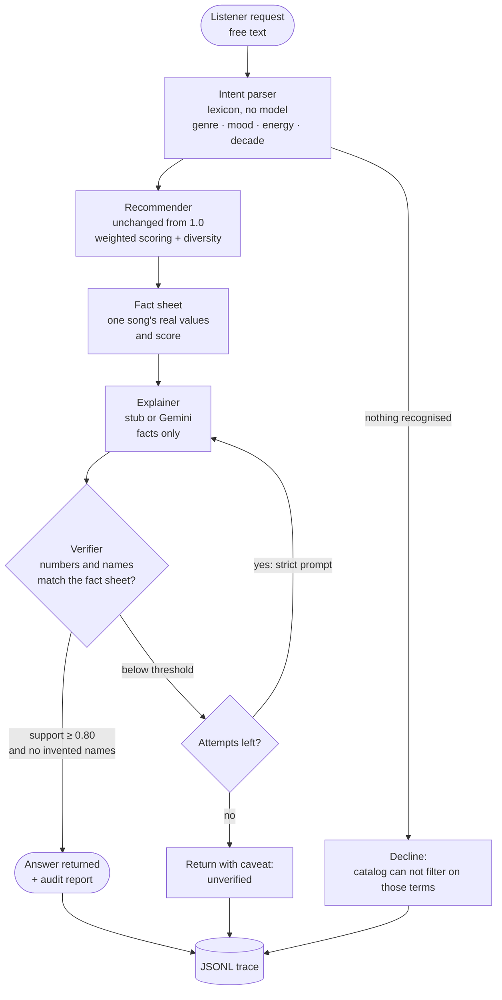

# 🎧 VibeFinder 2.0 — grounded recommendations

A content-based music recommender whose **explanations are audited before you see them**.
The recommender from VibeFinder 1.0 is unchanged; what is new is a layer that writes a
justification for the top result, checks every claim in it against the song's real data, and
retries once with a stricter prompt if the check fails. If it still fails, you are told.

> **Design rule:** a recommendation you cannot justify is not finished — and a justification
> that cannot be checked is not a justification.

| | |
|---|---|
| **Base project** | VibeFinder 1.0 (AI110 Module 3 show): 31-song catalog, weighted scoring, diversity penalty |
| **What 2.0 adds** | Free-text intent parser → grounded explanation writer → deterministic verifier → one retry → caveat |
| **AI feature** | Agentic workflow with a reliability gate (verify-and-retry on model output) |
| **Catalog** | 31 songs, 25 genres, 15 moods |
| **Tests** | 47 offline tests (32 inherited, 15 new) — no API key needed |
| **Harness** | 16 queries × 2 modes, pass/fail, JSONL traces |
| **Dependencies** | standard library for the core; `google-genai` only for live explanations |

---

## Where this came from

This extends **VibeFinder 1.0**, a Module 3 project: a content-based recommender that scores
each song against a listener's taste profile on genre, mood, energy, tempo, danceability,
acousticness, popularity and era, then prints a ranked top-5 with the reason for every point.
Its goal was full explainability — every score printed as a sum of numbered parts.

The weakness that motivated 2.0 is that all of that reasoning was written by hand in templates.
The moment an LLM writes the explanation instead, the explanation can drift from the data: it
can invent a release year, name a song that does not exist, or round an energy value to
something flattering. That is the failure mode this project engineers away.

---

## Architecture



The Mermaid source is in `diagrams/architecture.mmd`.

**Why the parser is rule-based.** Mapping "something chill for studying" to a profile is a
lookup problem, not a language-understanding problem, and a lexicon can be inspected, tested
and corrected. Keeping the model out of that step means a wrong recommendation is always
traceable to a rule you can read.

**Why the verifier is deterministic.** Asking a second model to grade the first adds a second
failure mode. Checking numbers against a row and names against a catalog is cheap, explainable,
and cannot be talked out of a verdict.

---

## Setup

```bash
python3 -m venv .venv && source .venv/bin/activate
pip install -r requirements.txt          # core needs nothing beyond the stdlib
cp .env.example .env                     # only needed for live explanations
python -m unittest discover -s tests -v  # 47 tests, no network
```

Live explanations need a Gemini key (`GEMINI_API_KEY` in `.env` or the environment).
Everything else — the parser, the recommender, the verifier, the loop, the harness — runs
offline against deterministic stubs.

---

## Try it

**1. A normal request, explainer is careful (offline stub):**

```text
$ python -m src.main --request "something chill lofi for studying" --provider stub

REQUEST: something chill lofi for studying
UNDERSTOOD AS: favorite_mood:chill, favorite_genre:lofi, energy:chill
RETRIEVED NOTES: study_sessions, rainy_afternoons
TOP MATCH: Library Rain — Paper Lanterns (lofi/chill) score 5.00
ALSO CONSIDERED: Midnight Coding (4.86); Spacewalk Thoughts (2.86); Focus Flow (3.90); Coffee Shop Stories (1.96)

EXPLANATION:
  "Library Rain" by Paper Lanterns is a chill lofi track from the 2020s with an energy of
  0.35 and a tempo of 72 BPM. It scores 5.00 against this profile, driven by calm, focused.

VERIFIER: GROUNDED  (claim support 1.00)
ATTEMPTS: 1
```

**2. The same pipeline with an explainer that invents things — one retry, then clean:**

```text
$ python -m src.main --request "upbeat pop for the gym" --provider stub-sloppy

REQUEST: upbeat pop for the gym
UNDERSTOOD AS: favorite_genre:pop, energy:gym
RETRIEVED NOTES: gym_sessions
TOP MATCH: Gym Hero — Max Pulse (pop/intense) score 3.94
EXPLANATION:
  "Gym Hero" by Max Pulse is an intense pop track from the 2020s with an energy of 0.93
  and a tempo of 132 BPM. It scores 3.94 against this profile, driven by euphoric, confident.
VERIFIER: GROUNDED  (claim support 1.00)
ATTEMPTS: 2  (one retry with a stricter prompt)
```

The first attempt is rejected by the verifier — it claimed a 2019 release and named a song
that does not exist — and the trace keeps the failed attempt, not just the winner.

**3. A request the catalog cannot serve — declined, not dressed up:**

```text
$ python -m src.main --request "polka death metal"

REQUEST: polka death metal
UNDERSTOOD AS: nothing recognised
IGNORED: polka, death, metal
STATUS: declined — none of those terms map to catalog features.
  None of those terms map to catalog features (genre, mood, energy, tempo, decade, popularity).
```

**4. Partial match, said out loud:** "1940s jazz ballads" returns a jazz song with
`CAVEAT: The catalog has no songs from the 1940s; this matches on genre only.`

---

## How verification works

The verifier reads the explanation and extracts **checkable claims**:

| Claim type | Check | Failure example |
|---|---|---|
| Numbers | within tolerance of that field in the song's row (0.06 for 0–1 features, ±2 for tempo/popularity, exact decade) | "released in 2019" when the row says 2020s |
| Quoted names | must exist in the catalog's titles or artists | "pairs well with *Midnight Velvet*" |
| Proper nouns | must exist in the catalog vocabulary (titles, artists, genres, moods, tags) | "a Motown classic" |

Claim support = supported ÷ total claims. The answer is accepted at **0.80** with no invented
names; otherwise the loop retries once with a stricter prompt, and then returns the explanation
*with a caveat* rather than hiding the failure.

Tolerance and thresholds are constants at the top of `src/verify.py`, so the strictness is a
policy decision you can see and change.

---

## Testing

```bash
python -m unittest discover -s tests -q     # 47 tests, no API key
python harness.py --provider stub-sloppy    # reliability harness, 16 queries × 2 modes
python scripts/compare_prompt_styles.py     # baseline vs specialized prompt evidence
```

**Test coverage.** 32 inherited recommender tests plus 15 new ones: intent parsing (mood and
genre together, unknown words reported not guessed, decade and popularity), verifier behaviour
(supported text grounds, invented year caught, invented title caught, no-claims text rejected),
context retrieval (relevant notes are attached, unrelated requests retrieve nothing), and the
loop (careful provider answers in one attempt, sloppy provider fails once then passes, attempt
cap produces a caveat, profile-only runs work, **and the loop does not change which song is
recommended** — only how it is described).

**Harness result** (`assets/harness_results.md`, generated by `harness.py`):

| Mode | Passed | What it measures |
|---|---|---|
| Explain-only | **5/16** | the model's raw output, accepted as written |
| Verified loop | **16/16** | the system: grounded answers, or an honest decline |

Ten answerable queries went from ungrounded to grounded; six unanswerable ones were declined
instead of answered. The provider here is `stub-sloppy`, a deterministic stand-in that invents a
release year and a song title, so the mechanism is reproducible without an API key. Pointing
`--provider gemini` at a live model runs the same 16 queries through the same checks.

The whole table is in `assets/harness_results.md`; every run also appends to
`assets/agentic_trace.jsonl`. Each trace line records the `parse → retrieve → rank → verify`
steps and every explanation attempt, including the failed one.

### Stretch-feature evidence

| Stretch feature | Evidence in this repo |
|---|---|
| RAG enhancement (+2) | `data/context_notes.json` adds a second, custom source of listener-context notes. Retrieval is integrated into `src/agent.py` and shown in the CLI output above (`RETRIEVED NOTES: study_sessions, rainy_afternoons`). |
| Agentic workflow enhancement (+2) | The JSONL trace in `assets/agentic_trace.jsonl` records intermediate steps, retrieved notes, the rejected attempt, the strict retry, and the final verdict; `ai_interactions.md` links and explains it. |
| Specialization (+2) | `python scripts/compare_prompt_styles.py` compares an unconstrained writer with a fact-only writer over 10 queries: mean claim support rises from **0.490 to 1.000**, and fabricated claims fall from **29 to 0**. `model_card.md` shows sample outputs. |
| Test harness (+2) | `python harness.py --provider stub-sloppy` runs 16 predefined queries in two modes and prints a pass/fail summary: **5/16 → 16/16**. |

---

## Design decisions and trade-offs

| Decision | Why | Cost |
|---|---|---|
| Rule-based intent parser instead of an LLM | Inspectable, testable, free, and keeps the model to one job | Limited vocabulary; new phrasings need new rules |
| Deterministic verifier instead of LLM-as-judge | No second model to fail, and the verdict is explainable to a grader | Catches factual drift, not bad judgement |
| One retry, then caveat | Bounded cost and latency; failure is disclosed, not hidden | A stubborn model still gets a caveated answer |
| Verify the **top** recommendation only | The explanation is per-song; verifying a list multiplies cost for little gain | Alternatives are listed without audited prose |
| Facts only from the row | Makes "grounded" a mechanical property | Explanations read a little dry |

**What I deliberately did not do:** fine-tune a model (no need — the failure was grounding, not
knowledge), add embeddings (the catalog is 30 rows; scarcity of vocabulary was the problem, not
semantic search), or build a UI (the CLI is the product here).

---

## Repo layout

```
ai110-music-final/
├── data/songs.csv              # 31-song catalog
├── data/profiles.json          # taste profiles (data, not code)
├── data/context_notes.json     # custom retrieval source for listener context
├── src/
│   ├── recommender.py          # 1.0 scoring and ranking (unchanged)
│   ├── nlu.py                  # free text → profile, with an honest report
│   ├── retrieval.py            # custom context-note retrieval
│   ├── facts.py                # fact sheet + catalog vocabulary
│   ├── llm.py                  # stub and Gemini writers behind one interface
│   ├── verify.py               # deterministic claim checking
│   ├── agent.py                # recommend → explain → verify → retry
│   └── main.py                 # CLI, including --request/--provider/--trace
├── harness.py                  # 16 queries × 2 modes → markdown + traces
├── scripts/compare_prompt_styles.py  # baseline vs specialized prompt comparison
├── tests/                      # 47 offline tests
├── diagrams/architecture.mmd   # Mermaid source
├── assets/                     # harness results and traces (evidence)
├── model_card.md
└── README.md
```

---

## What this project says about me as an AI engineer

I can tell the difference between a feature that demos well and a feature that survives
contact with a model's imagination. The interesting work here was not prompting — it was
deciding what the model is *allowed* to say, building a cheap check that can prove it, and
being willing to show the retry that failed. The harness is the part I would take to an
interview: it turns "it feels better" into 5/16 versus 16/16.

---

## Presentation outline (5–7 min)

1. The base system and the one weakness that mattered: hand-written explanations (1 min)
2. Why an LLM explanation can drift from a 30-row catalog, with a real example (1 min)
3. The loop: parse → retrieve context → recommend → fact sheet → explain → verify → retry
   (2 min, live demo of the sloppy provider being caught and corrected)
4. Harness: 5/16 → 16/16, and the six declines (1 min)
5. What is still broken: lexicon coverage, verifier tolerance, one retry only (1 min)
6. What I would do next: live-model harness run, claim-level explanations for alternatives,
   a stricter numeric schema (30 s)
